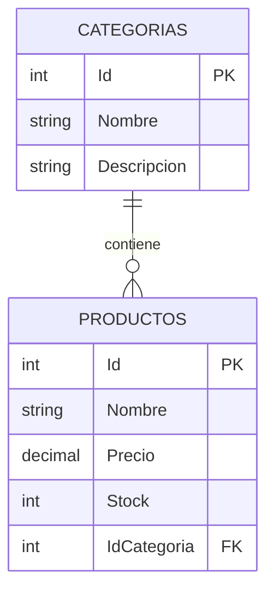
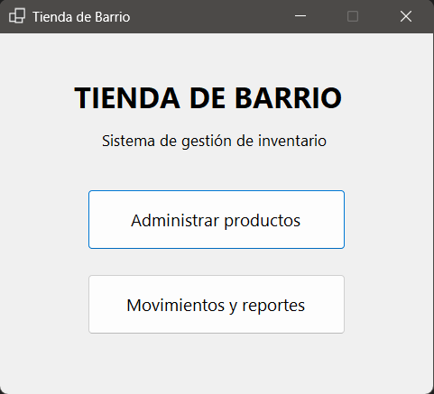

# 🏪 Tienda de Barrio

## 1. Información del proyecto

**Nombre:** Tienda de Barrio

**Caso:** Sistema de escritorio para administrar los productos y las categorías de una tienda de barrio.

**Descripción:**

Tienda de Barrio es una aplicación de escritorio desarrollada en C# con Windows Forms, Entity Framework Core y SQLite. Su propósito es facilitar la administración del inventario de una tienda, permitiendo registrar, consultar, modificar y eliminar productos, organizarlos por categorías, controlar las existencias y generar reportes para conocer el estado del inventario.

La aplicación utiliza una arquitectura por capas para separar los modelos, el acceso a los datos, las reglas del negocio y la interfaz gráfica.

### Integrantes

| Integrante | Rol | Responsabilidades |
|---|---|---|
| Miguel Posada | Líder técnico | Configuración del proyecto, repositorio, paquetes NuGet, contexto de base de datos, inicialización y ventana principal. |
| Luis Enrique Vergara | Modelos y datos | Entidades, relación entre tablas, interfaces y repositorios de datos. |
| María Isabel Correa | Servicios | Reglas del negocio, validaciones, consultas LINQ y funcionalidades de productos y reportes. |

---

## 2. Funcionalidades de la aplicación

### Gestión de productos

- Registrar nuevos productos.
- Consultar los productos registrados.
- Modificar la información de un producto.
- Eliminar productos.
- Asignar una categoría a cada producto.
- Buscar productos por nombre.
- Consultar el precio y las existencias disponibles.
- Consultar productos organizados por nombre.

### Gestión de categorías

- Registrar categorías mediante el repositorio de datos.
- Consultar las categorías existentes.
- Buscar categorías por identificador o nombre.
- Modificar categorías.
- Eliminar categorías cuando no tengan productos asociados.

### Control de inventario

- Registrar ventas y descontar existencias.
- Agregar unidades al inventario.
- Consultar productos con stock bajo.
- Consultar el inventario completo.
- Consultar el valor total del inventario agrupado por categorías.

### Validaciones

- El nombre del producto es obligatorio.
- El precio debe ser mayor que cero.
- El stock no puede ser negativo.
- Todo producto debe tener una categoría válida.
- No se permite eliminar una categoría que tenga productos asociados.
- Los errores deben mostrarse mediante mensajes y no deben cerrar inesperadamente la aplicación.

### Persistencia de datos

La información se almacena en una base de datos SQLite mediante Entity Framework Core. Los datos permanecen guardados aunque se cierre la aplicación.

---

## 3. Reportes con LINQ

La aplicación cuenta con consultas para analizar el inventario.

### Reporte 1. Productos con stock bajo

Permite consultar los productos cuyas existencias sean iguales o inferiores a una cantidad mínima seleccionada por el usuario.

Muestra información de los productos encontrados y permite identificar cuáles necesitan reposición.

### Reporte 2. Inventario por categorías

Agrupa los productos según su categoría y calcula:

- Nombre de la categoría.
- Cantidad de productos asociados.
- Unidades disponibles.
- Valor total del inventario de cada categoría.

Para generar estos resultados se utilizan consultas LINQ con operaciones como `GroupBy`, `Select`, `Count` y `Sum`.

---

## 4. Formularios de la aplicación

| Formulario | Función |
|---|---|
| FormPrincipal | Ventana principal y navegación entre las funcionalidades. |
| FormProductos | Registro, consulta, modificación, eliminación y búsqueda de productos. |
| FormMovimientos | Gestión de movimientos de entrada y salida de existencias. |
| FormReportes | Consulta del inventario, productos con stock bajo y resumen por categorías. |

---

## 5. Arquitectura del proyecto

El proyecto está organizado en cuatro capas:

```text
tienda-de-barrio-main/
│
├── Modelos/
│   └── Modelos/
│       ├── Categoria.cs
│       └── Producto.cs
│
├── Datos/
│   ├── Interfaces/
│   │   ├── IRepositorioCategorias.cs
│   │   └── IRepositorioProductos.cs
│   ├── InventarioContext.cs
│   ├── InicializadorBaseDatos.cs
│   ├── RepositorioCategorias.cs
│   └── RepositorioProductos.cs
│
├── Servicios/
│   └── Servicios/
│       └── ServicioInventario.cs
│
├── Presentacion/
│   └── Presentacion/
│       ├── FormPrincipal.cs
│       ├── FormProductos.cs
│       ├── FormMovimientos.cs
│       ├── FormReportes.cs
│       └── Program.cs
│
├── TiendaDeBarrio/
│   └── TiendaDeBarrio.slnx
│
├── docs/
│   └── capturas/
│       └── tienda-de-barrio.png
│
└── README.md
```

### Miguel Posada — Líder técnico

Responsable de:

- Crear y configurar el repositorio de GitHub.
- Crear y organizar los proyectos de la solución.
- Instalar y configurar los paquetes NuGet.
- Configurar las referencias entre las capas.
- Configurar `InventarioContext.cs`.
- Implementar la inicialización de la base de datos.
- Desarrollar la ventana principal.
- Documentar el proyecto en `README.md`.

### Luis Enrique Vergara — Modelos y datos

Responsable de:

- Crear `Categoria.cs`.
- Crear `Producto.cs`.
- Establecer la relación entre productos y categorías.
- Crear `IRepositorioCategorias.cs`.
- Crear `IRepositorioProductos.cs`.
- Desarrollar `RepositorioCategorias.cs`.
- Desarrollar `RepositorioProductos.cs`.

### María Isabel Correa — Servicios

Responsable de:

- Desarrollar `ServicioInventario.cs`.
- Implementar las reglas del negocio.
- Implementar las validaciones de productos y movimientos.
- Desarrollar las consultas LINQ.
- Implementar los reportes del inventario.
- Participar en el desarrollo de los formularios de productos y reportes.

**Nota:** Aunque cada integrante tiene responsabilidades principales, todos participan en la integración, revisión y pruebas de la aplicación. Cada integrante debe aportar cambios al repositorio compartido mediante sus propios commits.

---

## 6. Base de datos y relación entre tablas

La aplicación utiliza SQLite y Entity Framework Core para almacenar y consultar la información.

La base de datos se inicializa automáticamente al ejecutar la aplicación por primera vez.

### Tabla Categorias

| Campo | Tipo | Descripción |
|---|---|---|
| Id | int | Identificador único de la categoría. |
| Nombre | string | Nombre de la categoría. |
| Descripcion | string | Descripción de la categoría. |

### Tabla Productos

| Campo | Tipo | Descripción |
|---|---|---|
| Id | int | Identificador único del producto. |
| Nombre | string | Nombre del producto. |
| Precio | decimal | Precio de venta del producto. |
| Stock | int | Unidades disponibles. |
| IdCategoria | int | Clave foránea que identifica la categoría del producto. |

### Diagrama entidad-relación



### Explicación de la relación

La relación entre las tablas es de uno a muchos:

- Una categoría puede tener varios productos.
- Cada producto pertenece a una categoría.
- `IdCategoria` es la clave foránea de la tabla Productos.
- La relación se configura mediante Entity Framework Core.
- No se permite eliminar una categoría que tenga productos asociados.

Por ejemplo, la categoría **Bebidas** puede contener productos como agua, gaseosa y jugo.

### Ubicación de la base de datos

El archivo SQLite se crea en la carpeta local de datos de la aplicación:

```text
%LOCALAPPDATA%\TiendaDeBarrio\tienda.db
```

---

## 7. Tecnologías utilizadas

- **C#:** lenguaje de programación.
- **.NET 10:** plataforma de desarrollo.
- **Windows Forms:** desarrollo de la interfaz gráfica.
- **Entity Framework Core:** ORM para trabajar con la base de datos.
- **SQLite:** sistema de almacenamiento de datos.
- **LINQ:** consultas, búsquedas y generación de reportes.
- **Git y GitHub:** control de versiones y trabajo colaborativo.
- **Visual Studio:** entorno de desarrollo.

---

## 8. Instrucciones para ejecutar el proyecto

### Requisitos

- Windows.
- Visual Studio con la carga de trabajo de desarrollo de escritorio con .NET.
- SDK de .NET 10.
- Acceso a Internet para restaurar los paquetes NuGet, si todavía no están instalados.

### Pasos para ejecutar

1. Clonar el repositorio desde GitHub.
2. Abrir la solución `TiendaDeBarrio.slnx`, ubicada en la carpeta `TiendaDeBarrio`.
3. Esperar a que Visual Studio restaure los paquetes NuGet.
4. Establecer `Presentacion` como proyecto de inicio.
5. Ejecutar con `F5` o `Ctrl + F5`.

La aplicación inicializa automáticamente la base de datos SQLite y registra datos de ejemplo cuando la base de datos está vacía.

### Ejecución mediante terminal

Desde la carpeta raíz del repositorio, también se puede ejecutar con:

```bash
dotnet restore Presentacion/Presentacion/Presentacion.csproj
dotnet run --project Presentacion/Presentacion/Presentacion.csproj
```

---

## 9. Captura de pantalla de la aplicación

A continuación se muestra una captura de la aplicación Tienda de Barrio en funcionamiento.



---

## 10. Objetivo final

Desarrollar una aplicación de escritorio funcional para administrar los productos y las categorías de una tienda de barrio, aplicando programación orientada a objetos, arquitectura por capas, interfaces, validaciones, relaciones entre tablas, persistencia de datos con SQLite y consultas LINQ.

El proyecto también busca fortalecer el trabajo colaborativo mediante Git y GitHub, distribuyendo responsabilidades entre los integrantes del equipo y manteniendo un repositorio compartido con los avances de cada participante.
