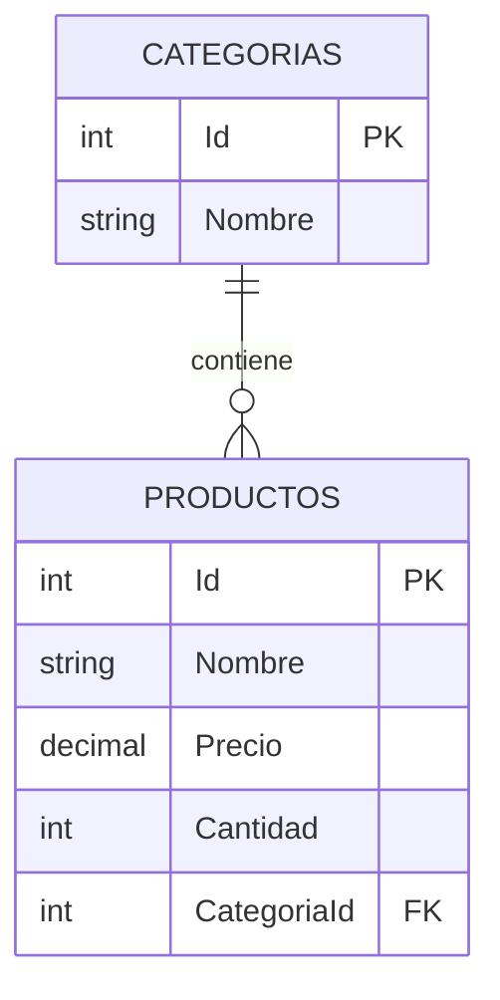

# 🏪 Tienda de Barrio

## 1. Información del proyecto

**Nombre:** Tienda de Barrio  
**Caso:** Sistema de escritorio para administrar los productos y las categorías de una tienda de barrio.

**Descripción:**

Tienda de Barrio es una aplicación de escritorio desarrollada en C# con Windows Forms, Entity Framework Core y SQLite. Su propósito es facilitar la administración de los productos de una tienda, permitiendo registrar, consultar, modificar y eliminar productos, organizar el inventario por categorías y generar reportes para conocer el estado de los productos registrados.

### Integrantes

| Integrante | Rol | Responsabilidades |
|---|---|---|
| Miguel Posada | Líder técnico | Configuración del proyecto, repositorio, paquetes NuGet, DbContext, ventana principal y documentación. |
| Luis Enrique Vergara | Modelos y datos | Entidades, relación entre tablas, repositorios y formulario de gestión de categorías. |
| María Isabel Correa | Servicios | Reglas del negocio, validaciones, consultas LINQ, reportes y formulario de gestión de productos. |

---

## 2. Funcionalidades de la aplicación

La aplicación contará con las siguientes funcionalidades:

### Gestión de productos
- Registrar nuevos productos.
- Consultar los productos registrados.
- Modificar la información de un producto.
- Eliminar productos.
- Asignar una categoría a cada producto mediante un ComboBox.
- Buscar productos por nombre.
- Consultar el precio y la cantidad disponible.
- Mostrar los productos organizados por nombre.

### Gestión de categorías
- Registrar categorías.
- Consultar las categorías existentes.
- Modificar el nombre de una categoría.
- Eliminar categorías cuando no tengan productos asociados.

### Validaciones
- El nombre del producto es obligatorio.
- El precio debe ser mayor que cero.
- La cantidad no puede ser negativa.
- Todo producto debe tener una categoría seleccionada.
- Los campos obligatorios deben validarse antes de guardar.
- La aplicación debe mostrar mensajes de error sin cerrarse cuando se ingresen datos incorrectos.

### Persistencia de datos
La información se almacenará en una base de datos SQLite mediante Entity Framework Core. Los datos permanecerán guardados aunque se cierre la aplicación.

---

## 3. Reportes con LINQ

La aplicación contará con dos reportes principales:

**Reporte 1. Inventario de productos**
- Lista de todos los productos registrados.
- Nombre del producto.
- Categoría.
- Precio.
- Cantidad disponible.
- Valor total por producto (precio × cantidad).

**Reporte 2. Resumen por categorías**
- Nombre de cada categoría.
- Cantidad de productos asociados.
- Valor total del inventario de cada categoría.
- Permite identificar qué categorías tienen más productos y mayor valor de inventario.

Los reportes se generarán mediante consultas LINQ sobre los datos almacenados.

---

## 4. Formularios de la aplicación

| Formulario | Función |
|---|---|
| FormPrincipal | Ventana principal y navegación entre las funcionalidades. |
| FormProductos | Registrar, consultar, editar, eliminar y buscar productos. |
| FormCategorias | Administrar las categorías de los productos. |
| FormReportes | Visualizar los reportes del inventario y el resumen por categorías. |

---

## 5. Arquitectura y reparto de archivos

El proyecto estará organizado en las siguientes capas:

```text
TiendaDeBarrio/
│
├── Modelos/
│   ├── Producto.cs
│   └── Categoria.cs
│
├── Datos/
│   ├── TiendaContext.cs
│   ├── IRepositorio.cs
│   └── Repositorio.cs
│
├── Servicios/
│   ├── ProductoServicio.cs
│   ├── CategoriaServicio.cs
│   └── ReporteServicio.cs
│
├── Escritorio/
│   ├── FormPrincipal.cs
│   ├── FormProductos.cs
│   ├── FormCategorias.cs
│   └── FormReportes.cs
│
├── Program.cs
└── README.md
```

### Miguel Posada — Líder técnico

Responsable de:
- Crear y configurar el repositorio de GitHub.
- Crear la solución y los proyectos.
- Instalar y configurar los paquetes NuGet.
- Configurar las referencias entre capas.
- Crear y configurar `TiendaContext.cs`.
- Desarrollar `FormPrincipal.cs`.
- Documentar el proyecto en `README.md`.

### Luis Enrique Vergara — Modelos y datos

Responsable de:
- Crear `Producto.cs`.
- Crear `Categoria.cs`.
- Establecer la relación entre productos y categorías.
- Desarrollar `IRepositorio.cs`.
- Desarrollar `Repositorio.cs`.
- Desarrollar `FormCategorias.cs`.

### María Isabel Correa — Servicios

Responsable de:
- Desarrollar `ProductoServicio.cs`.
- Desarrollar `CategoriaServicio.cs`.
- Desarrollar `ReporteServicio.cs`.
- Implementar las validaciones y reglas del negocio.
- Desarrollar las consultas LINQ de los reportes.
- Desarrollar `FormProductos.cs` y `FormReportes.cs`.

**Nota:** Aunque cada integrante tiene responsabilidades principales, todos participarán en la integración, revisión y pruebas de la aplicación. Cada uno será responsable de sus propios archivos y realizará commits en el repositorio compartido.

---

## 6. Base de datos y relación entre tablas

La aplicación utilizará SQLite y Entity Framework Core.

Se tendrán dos tablas principales:

### Tabla Categorias

| Campo | Tipo | Descripción |
|---|---|---|
| Id | int | Identificador único de la categoría. |
| Nombre | string | Nombre de la categoría. |

### Tabla Productos

| Campo | Tipo | Descripción |
|---|---|---|
| Id | int | Identificador único del producto. |
| Nombre | string | Nombre del producto. |
| Precio | decimal | Precio de venta del producto. |
| Cantidad | int | Unidades disponibles. |
| CategoriaId | int | Identificador de la categoría relacionada. |

### Diagrama entidad-relación



### Explicación de la relación

La relación será de uno a muchos:

- Una categoría puede tener varios productos.
- Cada producto pertenece a una sola categoría.
- `CategoriaId` será la clave foránea de la tabla Productos.
- En el formulario de productos se utilizará un ComboBox para seleccionar la categoría correspondiente.

Por ejemplo, la categoría **Bebidas** puede contener productos como agua, gaseosa y jugo.

---

## 7. Tecnologías utilizadas

- **C#:** lenguaje de programación de la aplicación.
- **Windows Forms:** desarrollo de la interfaz gráfica.
- **.NET:** plataforma de desarrollo.
- **Entity Framework Core:** ORM utilizado para trabajar con la base de datos desde C#.
- **SQLite:** sistema de base de datos.
- **LINQ:** consultas para búsquedas y reportes.
- **Git y GitHub:** control de versiones y trabajo colaborativo.

---

## 8. Ejecución del proyecto

1. Clonar el repositorio.
2. Abrir la solución en Visual Studio.
3. Restaurar los paquetes NuGet.
4. Verificar las referencias entre los proyectos.
5. Ejecutar el proyecto de escritorio.

La base de datos SQLite se creará automáticamente si todavía no existe.

---

## 9. Objetivo final

Desarrollar una aplicación de escritorio funcional para administrar los productos y las categorías de una tienda de barrio, aplicando programación orientada a objetos, arquitectura por capas, relaciones entre tablas, persistencia de datos con SQLite y consultas LINQ.
